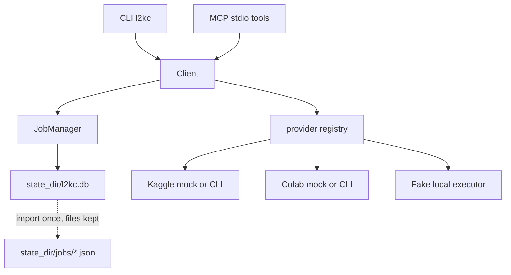

# Architecture

Business logic lives in `link2kaggle_colab.client.Client`. The CLI and the MCP server construct a client and return its data. They do not schedule work, submit jobs, or remember which provider owns a job.

`submit` stores a row in `state_dir/l2kc.db`. The id returned to the caller is our `job_id` (a new uuid4 hex). The id returned by the provider is stored as `provider_job_id` and is what status, logs, download, and cancel send to that provider. A later process builds a new `Client` with the same state directory and routes those calls through the row. An unknown or malformed id raises `JobNotFoundError`.

The first job operation imports any V0.2 `state_dir/jobs/<job_id>.json` index into the database as `UNKNOWN` with origin `json_migration`. The import is idempotent. JSON files are not modified or deleted. Existing SQLite rows are not overwritten.

`JobManager` calls `provider.submit` and `provider.cancel` at most once. Status, logs, and download retry only transient failures. A timed-out or otherwise ambiguous submit becomes `UNKNOWN` and is never resubmitted. `reconcile` polls provider status for active jobs, including `UNKNOWN`, and does not submit.

Provider calls run on dedicated non-daemon threads (`l2kc-submit`, `l2kc-status`, `l2kc-logs`, `l2kc-download`, `l2kc-cancel`), not the event-loop default executor. A configured timeout returns control to `Client` and to MCP while that thread may still be finishing. The submit thread stays non-daemon so process exit still waits for a late provider id to be stored and for the Colab adapter to stop its runtime. A status, logs, download, or cancel timeout is `TransientProviderError` (`transient_error`, `details.timed_out`). Status, logs, and download may retry it. Cancel is not retried, and the row stays `CANCELLING`.

Errors that leave the client are `L2KCError` with redacted messages. `Client._call` wraps an unexpected exception as `internal_error`. A manager timeout is `transient_error` or `submit_outcome_unknown`, not `internal_error`. Redaction covers token shapes, authorization headers, env-style assignments (`KAGGLE_KEY`, `HF_TOKEN`, `DB_PASSWORD`, `AWS_SECRET_ACCESS_KEY`, and the same `*_KEY` / `*_TOKEN` / `*_SECRET` / `*_PASSWORD` family), and mapping values whose key names a secret (`api_key`, `token`, `client_secret`, and the same family). `idempotency_key`, `gpu: T4`, and `key=short` stay visible. The job store applies that redaction before writing `message` and `details`.

## Placement

`recommend_backend` and GPU `submit` call `select_backend`. They do not compare CCU with GPU-hours. Kaggle is first when its quota check passes. Colab is the paid fallback and needs `timeout_seconds` so the CCU budget can be checked. A premium GPU needs `scheduler.allow_premium_gpu` and, unless confirmation is turned off, the per-job `allow_premium` flag. Pinning `--provider` does not skip that gate. The chosen provider is submitted once; an error or an `UNKNOWN` / `SUBMITTING` handle is not retried on the other provider.

CPU requests, and anything pinned to `fake`, skip the scheduler and use the offline executor.

## Layout

- `link2kaggle_colab.core` — errors, redaction, models, settings, paths, subprocess runner.
- `link2kaggle_colab.auth` — mock scenarios and real credential-source detectors.
- `link2kaggle_colab.providers` — sync `Provider`, registry, Kaggle and Colab mocks, real CLI adapters, offline `FakeProvider`.
- `link2kaggle_colab.client` — SDK used by everything above the providers.
- `link2kaggle_colab.cli` — Typer app `l2kc`.
- `link2kaggle_colab.mcp` — stdio server `link2kaggle-colab`. The installed MCP SDK is 2.x: `mcp.server.mcpserver.MCPServer` (`FastMCP` was renamed).
- `quota` — CCU estimates and the in-process quota cache shared by `l2kc quota` and the scheduler.
- `scheduler` — candidate catalog and `select_backend`. It does not submit.
- `jobs` — state machine (`TRANSITIONS`, `ACTIVE_STATES`) and async `JobManager`. Recovery polls active states, including `UNKNOWN`, and does not resubmit them. Submit and cancel run once. Status, logs, and download use the retry policy.
- `storage` — `SqliteJobStore` at `state_dir/l2kc.db` (WAL). The client routes jobs through this store. A V0.2 `state_dir/jobs/<job_id>.json` index imports as `UNKNOWN` with origin `json_migration`; existing rows and the JSON files stay untouched.
- `accounts` — registry, credential references, and account selection.

## Accounts

`AccountRegistry` loads `accounts` from settings. A provider with no configured row still gets an implicit `<provider>-default` ambient account, enabled only when that provider is enabled. A configured account whose provider is disabled is disabled too. `select_account` returns the explicit account or that provider's default. It does not consult quota, and it never substitutes another account of the same provider.

Each account has its own child environment (`AccountEnv`). Real CLI adapters pass that overlay on every command and build credential detectors from a copy of the process environment plus the overlay. They do not mutate `os.environ`. `account.mock_scenario` overrides the provider mock scenario. The quota cache key is `(provider, account_id)`.

Non-implicit adapter and mock state lives under `state_dir/accounts/<account_id>/`. Implicit defaults keep the historical `state_dir/kaggle`, `state_dir/colab`, `state_dir/mock/<provider>`, and `state_dir/fake` paths. Credential settings are references (path, env var name, or keyring identity), not secret values. Two accounts that resolve to the same location are rejected.

Jobs store `account_id`. Status, logs, download, cancel, and reconcile use the account stored on the row. A disabled or unknown account is refused before a provider call. Reconcile reports those rows as skipped and leaves them unchanged. An idempotency key that already belongs to another account is a conflict and does not insert a second row. Pre-V0.4 rows are backfilled as `<provider>-default`; when that id is not configured, it follows the provider's current default.

`register_provider_factory` and `load_entry_point_factories` (`link2kaggle_colab.providers`) add providers. Loading entry points is explicit and does not run at import. Built-in names win. `ProviderName` stays `kaggle`, `colab`, and `fake`, so a plugin name is not accepted by config in V0.4.

Default runtime mode is mock. See `docs/mock-mode.md`.

Kaggle and Colab API shapes are in `docs/api-verification.md`. Real calls go through the official CLIs only when `mode` is `real`, and a submit also needs `allow_real_jobs`.
